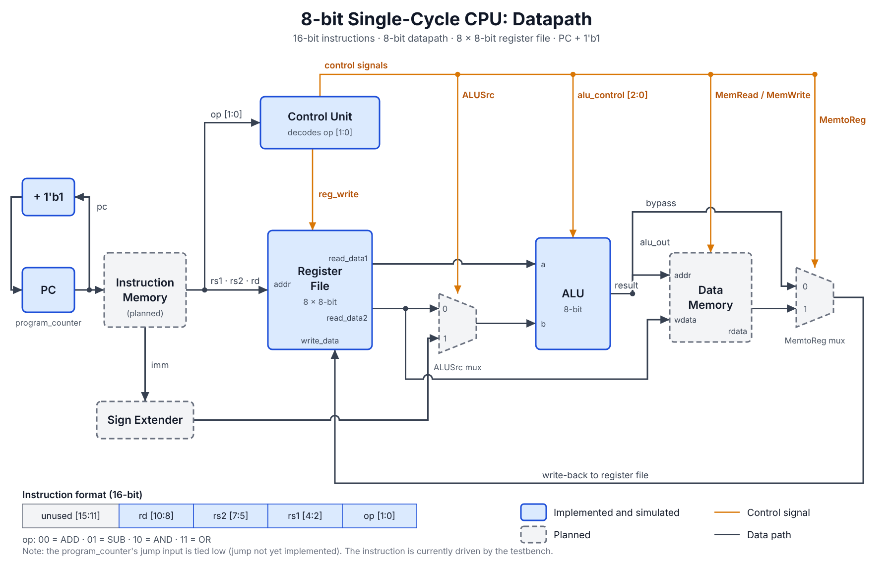

# 8-Bit Single-Cycle CPU

## Overview
A structural implementation of an 8-bit single-cycle CPU datapath designed from scratch using Verilog HDL. The processor executes instructions cycle-by-cycle, integrating essential processing elements into a unified top-level netlist to achieve fundamental arithmetic and logic execution. 

This project is part of a larger roadmap to design a fully pipelined CPU architecture.

## Architecture Datapath

## Hardware Modules
- **Program Counter (PC):** An 8-bit sequential register that determines the next instruction address. Handles normal incrementation and jump operations, driven by an active-high asynchronous reset.
- **Control Unit:** A combinational decoder that processes the instruction opcode to dynamically assert control signals, managing register write-enables and ALU opcode routing without generating unwanted latches.
- **Register File:** Contains 8 general-purpose 8-bit registers supporting simultaneous dual-port asynchronous reads and single-port synchronous writes.
- **ALU (Arithmetic Logic Unit):** An 8-bit combinational module executing `ADD`, `SUB`, `AND`, and `OR` operations, featuring an integrated zero-flag output for future branch logic readiness.

## Instruction Set Architecture (ISA)
Currently, the CPU supports a custom 16-bit instruction format focusing on R-type arithmetic and logic instructions:
- **`ADD`**: Adds values from `rs1` and `rs2`, storing the result in the `rd` register.
- **`SUB`**: Subtracts `rs2` from `rs1`, writing the output to `rd`.
- **`AND` / `OR`**: Executes bitwise logic operations on the source registers.

*Note: The opcode format will be expanded in the next iteration to support `LOAD` and `STORE` memory operations.*

## Simulation & Verification
The design is structurally mapped in `cpu_single_cycle.v` and verified using **Xilinx Vivado (2025.2)**. 

A bespoke testbench (`cpu_single_cycle_tb.v`) verifies the datapath by:
- Injecting backdoor data into the register file to bypass the current lack of data memory.
- Feeding 16-bit instruction opcodes directly into the datapath.
- Validating zero-delay combinational logic updates and cycle-accurate execution for `ADD` and `SUB` loops.

## Next Steps (Roadmap)
- [ ] Integrate Data Memory module to support `LOAD` and `STORE` instructions.
- [ ] Implement branch logic for the `JUMP` instruction.
- [ ] Refactor into a 5-stage pipelined architecture handling data hazards and stalls.